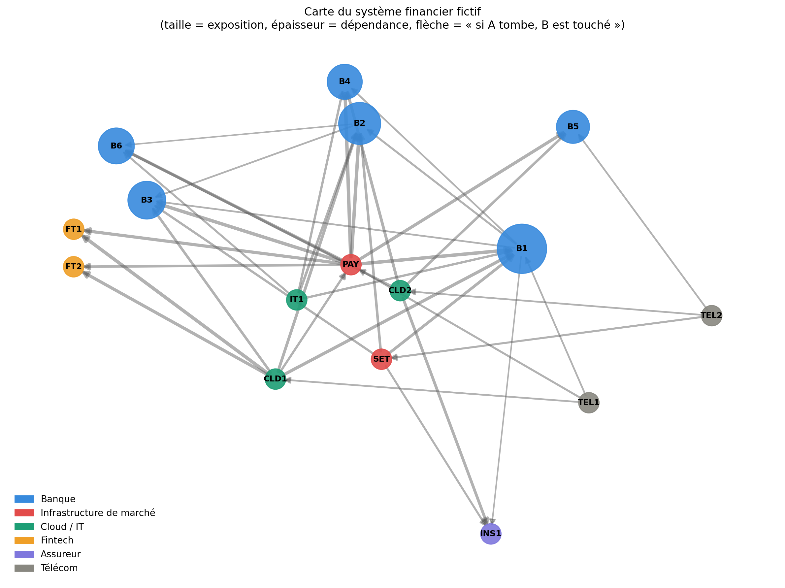

# Cyber-stress test d'un système financier

Ce projet simule la propagation d'une cyberattaque dans un système financier  de 16 acteurs (banques, infrastructures de marché, prestataires cloud/IT, fintechs, assureur, télécoms), puis mesure l'impact sur les ratios prudentiels des banques.

Il reproduit en un seul notebook une chaîne d'analyse complète : **cartographie → structure → propagation → impact financier → sensibilité et recommandations**.

> **Avertissement.** Toutes les données sont simulées. Les résultats illustrent une méthode ; ils ne décrivent aucun système réel et ne doivent pas être interprétés comme des estimations calibrées.

---

## Sommaire

1. [Question posée](#question-posée)
2. [Contenu du dépôt](#contenu-du-dépôt)
3. [Installation et exécution](#installation-et-exécution)
4. [Méthodologie](#méthodologie)
5. [Résultats principaux](#résultats-principaux)
6. [Paramètres modifiables](#paramètres-modifiables)
7. [Fichiers produits](#fichiers-produits)
8. [Limites](#limites)
9. [Pistes d'amélioration](#pistes-damélioration)

---

## Question posée

Si un acteur critique (cloud commun, infrastructure de paiement, banque systémique) subit une cyberattaque, **jusqu'où l'incident se propage-t-il, et combien de banques franchissent leurs seuils prudentiels ?**

## Contenu du dépôt

```
cyber-stress/
├── cyber_stress_test.ipynb   # notebook principal (étapes 1 à 5)
├── README.md
├── data/                     # CSV générés à l'exécution
└── figures/                  # figures PNG générées à l'exécution
```

Les dossiers `data/` et `figures/` sont créés automatiquement par le notebook.

## Installation et exécution

**Prérequis** : Python 3.9 ou plus récent.

```bash
pip install networkx pandas numpy matplotlib scipy jupyter
jupyter notebook cyber_stress_test.ipynb
```

Les résultats sont reproductibles : la graine aléatoire est fixée (`SEED = 42`).

## Méthodologie

| Étape | Contenu | Outils |
|---|---|---|
| **1. Cartographie** | 16 nœuds (maturité cyber 1-5, exposition, RTO) et 38 liens (dépendance, substituabilité, vitesse de propagation, type). Contrôle de cohérence des données, graphe orienté, visualisation | `networkx`, `pandas` |
| **2. Structure** | PageRank sur le graphe inversé, intermédiarité, concentration des prestataires (banques touchées en direct et par chaînage), points de défaillance uniques (SPOF) | `networkx` |
| **3. Propagation** | Simulation Monte-Carlo (1 000 tirages) de 3 scénarios mappés MITRE ATT&CK | `numpy`, `heapq` |
| **4. Impact financier** | Durée d'indisponibilité → perte opérationnelle et retraits de dépôts → CET1 et LCR avant/après, détection des seuils franchis | `pandas` |
| **5. Sensibilité** | Variation de la substituabilité et de la maturité cyber, test de deux mesures correctives | `numpy`, `matplotlib` |

### Convention de modélisation

Un arc `A → B` signifie **« si A tombe, B est impacté »** : il va du fournisseur vers le client.

### Modèle de transmission

Quand un nœud est touché, chaque arc sortant transmet l'incident avec la probabilité :

```
p(u → v) = dépendance × (1 − substituabilité) × vulnérabilité(v)
vulnérabilité(m) = (6 − m) / 5        # maturité 1 → 1,0 ; maturité 5 → 0,2
```

Les nœuds sont traités par ordre de temps croissant (file de priorité), ce qui donne le délai d'infection le plus court.

### Scénarios

| Identifiant | Technique MITRE ATT&CK | Nœud choc |
|---|---|---|
| `T1195_cloud` | T1195 — Supply Chain Compromise | CLD1 (cloud commun) |
| `T1498_pay` | T1498 — Network Denial of Service | PAY (infrastructure de paiement) |
| `T1486_b1` | T1486 — Data Encrypted for Impact | B1 (banque systémique) |

### Impact prudentiel

- **Durée d'indisponibilité** d'une banque touchée = `max(RTO du nœud choc, RTO de la banque)`.
- Une **table à 5 paliers** convertit la durée en perte opérationnelle (points de CET1) et en retraits de dépôts (%).
- `CET1 après = CET1 avant − perte` ; `LCR après = LCR avant × (1 − retraits)`.
- Seuils simplifiés : **CET1 < 10,5 %** et **LCR < 100 %**.
- Indicateur de synthèse : **espérance du nombre de banques sous seuil** = somme, sur les banques, du taux de contagion multiplié par l'indicatrice de franchissement.

## Résultats principaux

Valeurs obtenues avec la configuration par défaut :

| Scénario | Banques touchées (espérance, sur 6) | Banques sous seuil (espérance) |
|---|---|---|
| T1195 — Cloud commun | 1,31 | 0,23 |
| T1498 — Paiement | 3,08 | 1,29 |
| T1486 — Rançongiciel B1 | 1,35 | 0,12 |

- **PAY** porte 7 des 12 liens critiques (dépendance ≥ 0,7 et substituabilité ≤ 0,3) ; CLD1 en porte 4.
- **TEL1, TEL2 et CLD1** atteignent les 6 banques par chaînage alors qu'ils n'en touchent que 1 à 3 en direct : ce sont des **risques cachés**.
- Les franchissements de seuil concernent **B4 et B6** (faible marge de CET1, RTO de 24 h). Le LCR n'est jamais franchi avec la calibration retenue.
- Sur le scénario le plus dangereux (PAY), la diversification du prestataire de paiement réduit l'indicateur de 40 %, le renforcement de la maturité de B4 et B6 de 48 %, et la combinaison des deux de 69 %.

## Paramètres modifiables

Regroupés dans la cellule de configuration du notebook :

| Paramètre | Valeur par défaut | Rôle |
|---|---|---|
| `SEED` | 42 | Graine aléatoire |
| `N_SIM` | 1000 | Nombre de tirages Monte-Carlo par scénario |
| `SEUIL_CET1` | 10,5 | Seuil CET1 (%) |
| `SEUIL_LCR` | 100 | Seuil LCR (%) |

Les données (nœuds, liens, bilans) et la table de correspondance durée → impact sont définies dans des cellules dédiées et peuvent être modifiées directement. La note de synthèse finale est **générée à partir des résultats** : elle se met à jour après chaque modification.

## Fichiers produits

**Données (`data/`)**

| Fichier | Contenu |
|---|---|
| `nodes.csv`, `links.csv` | Nœuds et liens du système |
| `structure_metrics.csv`, `spof.csv` | Métriques de structure, liens critiques |
| `contagion_<scénario>.csv` | Taux de contagion et délai moyen par nœud |
| `banks_balance.csv` | Bilans des banques |
| `impact_<scénario>.csv`, `impact_all_scenarios.csv`, `impact_synthese.csv` | Impact CET1 / LCR |
| `sensibilite_substituabilite.csv`, `sensibilite_maturite.csv`, `effet_mesures.csv` | Sensibilité et mesures |

**Figures (`figures/`)**

| Fichier | Contenu |
|---|---|
| `fig1_graphe.png` | Cartographie du système |
| `fig2_structure.png` | PageRank, intermédiarité, banques atteignables |
| `fig3_contagion.png` | Taux de contagion par scénario |
| `fig4_impact_cet1.png` | CET1 avant/après par scénario |
| `fig5_sensibilite.png` | Sensibilité et effet des mesures |



## Limites

- **Données fictives**, sans calibrage empirique.
- **Pas de canal de confiance** : les retraits de dépôts dépendent uniquement de la durée d'indisponibilité, sans effet de panique.
- **LCR très simplifié** : les retraits réduisent le ratio proportionnellement, sans modéliser actifs liquides ni flux sortants.
- **Pas de comportement adaptatif** (bascule vers un prestataire de secours, intervention d'une autorité) ni de corrélation entre chocs.
- **Scénarios testés isolément** : pas de multi-chocs simultanés.
- **Bruit de simulation** : avec 1 000 tirages, un taux de contagion est connu à environ ±3 points ; les résultats comparent surtout des ordres de grandeur.
- **Effet de seuil** : la table à paliers crée des discontinuités.
- Dans ce modèle, la maturité cyber n'agit que sur la **cible** d'une transmission ; le nœud choc est compromis par hypothèse.
---

**Réalisées par Bouzagrar Siham et Khawla Kadiri**  
dans le cadre du projet *Cyber-stress test d’un système financier * – Novembre 2026.

## Références

- [MITRE ATT&CK](https://attack.mitre.org/) : techniques T1195, T1498, T1486.
- [NIST Cybersecurity Framework](https://www.nist.gov/cyberframework) : inspiration de l'échelle de maturité.
- [NetworkX](https://networkx.org/) : analyse de graphes.
